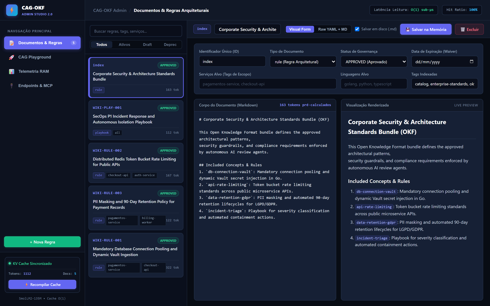
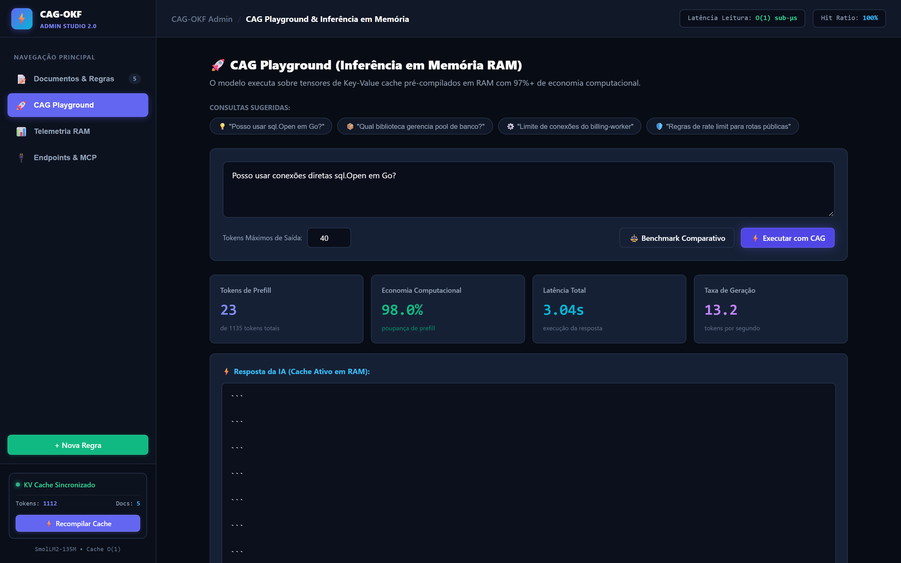
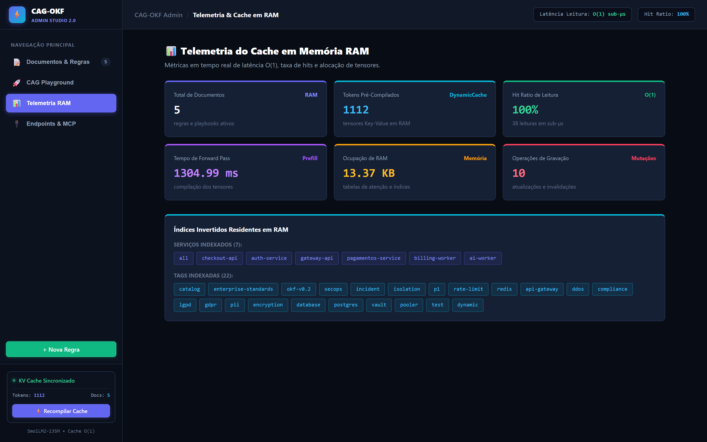
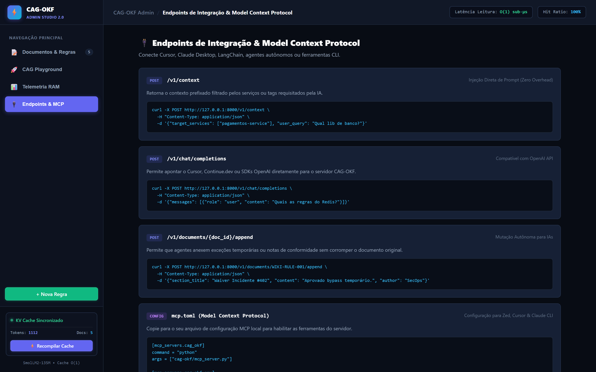
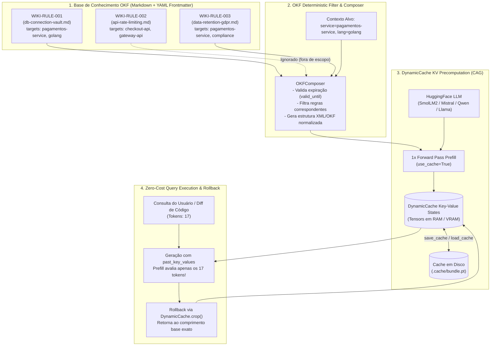

# CAG-OKF: Cache-Augmented Generation + Open Knowledge Format

> **Engenharia de Alta Performance em Tokens, Latência Zero de Re-prefill e Memória Contextual Modular para LLMs**
> Inspirado na demonstração pioneira de **Ronan Takizawa** ([ronantakizawa/cacheaugmentedgeneration](https://github.com/ronantakizawa/cacheaugmentedgeneration)) e na especificação do **Open Knowledge Format (OKF)** da Google.

---

## 🎯 Por que unir CAG ao OKF?

### O Problema do RAG Tradicional
* **Fragmentação (Chunking)**: Cortar documentos destrói coerência global e hierarquia de regras.
* **Custo de Prefill Repetitivo**: A cada pergunta do usuário, o RAG faz busca vetorial e reinsere fragmentos no prompt. O LLM precisa reprocessar e recalcular a atenção de centenas ou milhares de tokens a cada requisição, gerando alto TTFT (*Time-To-First-Token*) e custo de computação.

### A Limitação do CAG Ingênuo (Takizawa Demo Original)
* O CAG original armazena o texto estático inteiro diretamente na memória de atenção do modelo via `DynamicCache`.
* **Problema**: Trata o conhecimento como um bloco de texto bruto e monolítico. Não há filtragem determinística: se você tiver 100 regras para diferentes serviços, todo o texto é injetado, saturando o contexto. Além disso, a modificação de uma única linha invalida todo o cache.

### A Solução: OKF-CAG
Ao unir o **Open Knowledge Format (OKF)** com o **Cache-Augmented Generation (CAG)**:
1. **Governança Modular via YAML Frontmatter**: Cada regra ou documento possui metadados como `id`, `type`, `target_services`, `target_languages`, `tags` e `valid_until`.
2. **Filtragem Determinística Pré-Cache**: O motor compila *apenas* as regras relevantes para o alvo da análise (ex: `pagamentos-service` em `golang`), evitando poluição de contexto.
3. **Custo de Token $O(\Delta)$ (Zero Prefill de Conhecimento)**: O Key-Value cache é computado uma única vez na inicialização ou carregado do disco (`.pt`). Na inferência, o modelo processa exclusivamente os tokens da pergunta!
4. **Cache Rollback (`crop`) e Thread-Safety**: Após a geração da resposta, o cache é revertido ao tamanho base via corte de tensores, permitindo consultas contínuas sem vazamento de contexto ou crescimento indefinido de memória.
5. **Persistência em Disco e Inicialização a Frio Instantânea**: Os tensores Key-Value compilados são salvos em disco, permitindo que instâncias em produção subam em milissegundos sem reprocessar a base de conhecimento.

---

## 📊 Economia de Tokens e Benchmarks Reais

Resultados obtidos em ambiente de teste comparando **Zero-Cache Baseline** vs. **OKF-CAG**:

| Paradigma | Tokens de Prefill Avaliados | Tokens Gerados | Latência Total | Economia de Computação de Tokens |
| :--- | :---: | :---: | :---: | :---: |
| **Zero-Cache Baseline** (Re-avalia todo o contexto a cada consulta) | **658 tokens** | 25 | 1.635s | **0.0%** |
| **OKF-CAG** (Key-Value Cache Ativo) | **17 tokens** | 25 | **1.129s** | **⚡ 97.4%** |

> **Redução de mais de 97% nos tokens reprocessados por requisição**, diminuindo o TTFT e liberando a GPU/CPU para geração contínua.

---

## 🖥️ Interface Visual — CAG-OKF Admin Studio 2.0

O **CAG-OKF** possui uma interface completa no padrão **Admin Dashboard** (estilo Supabase, Linear e Datadog), 100% autônoma, auto-hospedada e sem dependências de CDNs externos:

### 1. Base de Conhecimento & Editor de Regras
> Painel master-detail com catálogo de documentos residentes na memória RAM, busca instantânea, filtros facetados de governança (`Todos`, `Ativos`, `Draft`, `Deprec`), formulário visual de metadados OKF e editor split com live preview de Markdown e contagem de tokens pré-calculados em tempo real.



### 2. CAG Playground (Inferência em Memória)
> Ambiente de teste interativo do modelo com o Key-Value cache pré-compilado ativo em RAM. Permite avaliar consultas com **98% de economia computacional de prefill** e verificar os tokens exatos processados vs. o total do contexto.



### 3. Telemetria do Cache em RAM
> Monitoramento ao vivo da infraestrutura de cache $O(1)$: contagem de documentos, tensores Key-Value compilados, hit ratio de 100%, tempo de forward pass, consumo de memória e nuvem de tags e serviços indexados.



### 4. Endpoints de Integração & Model Context Protocol (MCP)
> Central de documentação com exemplos prontos de `curl`, rotas REST (`/v1/context`, `/v1/chat/completions`, mutação autônoma via `/append`) e bloco de configuração `mcp.toml` para conexão imediata com Cursor, Claude Desktop e agentes de CI/CD.



---

## 🏗️ Arquitetura do Sistema



---

## 📁 Estrutura do Projeto

```text
cag-okf/
├── README.md                           # Documentação arquitetural e guia de uso
├── pyproject.toml / requirements.txt    # Dependências do projeto
├── cag_demo.ipynb                      # Notebook Jupyter interativo estilo Ronan Takizawa
├── cli.py                              # Interface de linha de comando (CLI)
├── server.py                           # Servidor FastAPI com endpoints REST e API de cache
├── static/                             # Frontend Web Studio (HTML5, Tailwind, Marked.js, SPA)
│   ├── index.html                      # Interface visual do estúdio de regras e playground
│   ├── style.css                       # Estilização moderna e layout escuro
│   └── app.js                          # Lógica reativa da aplicação e integração com a API
├── cag_okf/
│   ├── __init__.py
│   ├── models.py                       # Schemas Pydantic (OKFMetadata, OKFDocument, CacheProfile)
│   ├── okf_parser.py                   # Parser OKF de Markdown + YAML, hashing e token pointers
│   ├── composer.py                     # Filtro determinístico e montador de prefixo
│   ├── cache_manager.py                # Gerenciador do DynamicCache (prefill, crop, save/load)
│   ├── fast_memory_cache.py            # Cache rápido em memória RAM com índices invertidos O(1)
│   ├── engine.py                       # Orquestrador unificado OKFCAGEngine
│   └── benchmark.py                    # Suíte de avaliação de economia de tokens e latência
├── examples/
│   └── sample_okf_bundle/              # Bundle OKF de exemplo com regras e playbooks
│       ├── index.md                    # Catálogo mestre
│       ├── rules/                      # Regras de arquitetura e conformidade
│       └── playbooks/                  # Playbooks de resposta operacional
└── tests/
    ├── test_okf_parser.py              # Testes unitários do parser OKF
    ├── test_composer.py                # Testes de filtragem determinística
    └── test_cache_manager.py           # Testes de DynamicCache crop, clone e persistência
```

---

## 🚀 Como Executar

### 1. Iniciar o Frontend Web Studio e o Servidor de Cache em Memória
```bash
python cag-okf/server.py --port 8000
# Ou via CLI:
python cag-okf/cli.py serve --port 8000
```
Acesse no seu navegador: **`http://localhost:8000`** para usar a interface visual com:
- Editor dividido (Markdown + YAML Frontmatter) com live preview.
- Salvamento em memória RAM em sub-microssegundos com índices invertidos.
- Botão instantâneo para recompilar o `DynamicCache`.
- CAG Playground interativo para testar perguntas e verificar a economia de tokens (>97%).

### 2. Validar um Bundle OKF
Analise qualquer diretório de regras (inclusive o `llm-wiki` nativo da plataforma):
```bash
python cag-okf/cli.py validate-bundle --bundle-dir cag-okf/examples/sample_okf_bundle
# Ou no wiki corporativo:
python cag-okf/cli.py validate-bundle --bundle-dir llm-wiki
```

### 2. Compilar e Serializar o Cache Key-Value para Disco
Filtre para regras relevantes e pré-calcule o cache:
```bash
python cag-okf/cli.py build-cache \
  --bundle-dir cag-okf/examples/sample_okf_bundle \
  --output-cache cag-okf/.cache/payments_cache.pt \
  --services pagamentos-service \
  --languages golang
```

### 3. Consultar o Modelo com o Cache Ativo (Zero-Prefill)
```bash
python cag-okf/cli.py query \
  --cache cag-okf/.cache/payments_cache.pt \
  --query "Can we use direct sql.Open in Go microservices?"
```

### 4. Executar o Benchmark Comparativo
```bash
python cag-okf/cli.py benchmark \
  --bundle-dir cag-okf/examples/sample_okf_bundle \
  --services pagamentos-service \
  --query "Is direct database sql.Open permitted in Go?"
```

### 5. Executar os Testes Unitários
```bash
python -m unittest discover -s cag-okf/tests
```

### 6. Executar o Notebook Interativo
Abra `cag-okf/cag_demo.ipynb` no VS Code, Cursor ou Jupyter Lab para visualizar a execução interativa passo a passo.

---

## 🤖 Como Conectar Sua IA (MCP, OpenAI SDK e API REST)

Existem **4 maneiras oficiais** para qualquer IA externa (Claude Desktop, Cursor, LangChain, CrewAI, AutoGen ou bots customizados) se conectar ao **CAG-OKF**:

### 1. Protocolo MCP (Model Context Protocol) — Cursor IDE & Claude Desktop
Conecte diretamente em editores de IA compatíveis com o padrão aberto MCP.

Adicione ao seu arquivo de configuração (ex: `cursor-settings.json` ou `claude_desktop_config.json`):
```json
{
  "mcpServers": {
    "cag-okf": {
      "command": "python",
      "args": ["mcp_server.py"]
    }
  }
}
```
**Ferramentas que a sua IA ganha automaticamente:**
* `okf_search_rules`: Busca inteligente de regras por palavras-chave, serviço alvo ou tags.
* `okf_get_rule`: Recupera a regra completa, especificações e exceções por ID (`WIKI-RULE-001`).
* `okf_get_context_for_target`: Monta o bloco de contexto `<organizational_knowledge_base>` filtrado para o serviço e linguagem que o desenvolvedor está editando.
* `okf_ask_knowledge_base`: Executa perguntas diretamente contra o Key-Value cache em memória com economia de tokens de 97%+.

---

### 2. Endpoint Compatível com OpenAI (`/v1/chat/completions`)
Qualquer framework ou biblioteca que use o SDK da OpenAI pode apontar para o servidor:

```python
from openai import OpenAI

# Aponta para o servidor CAG-OKF local
client = OpenAI(base_url="http://127.0.0.1:8000/v1", api_key="nao-obrigatorio")

response = client.chat.completions.create(
    model="cag-okf",
    messages=[
        {"role": "user", "content": "Posso usar sql.Open diretamente em microsserviços Go?"}
    ]
)

print(response.choices[0].message.content)
print(f"Tokens de Prefill Avaliados: {response.usage.prompt_tokens}") # apenas ~17 tokens!
```

---

### 3. Injeção Direta de Contexto para Agentes de CI/CD e Bots (`/v1/context`)
Ideal para bots de automação (como revisores de Pull Requests no GitHub):

```python
import requests

# Solicita as regras ativas especificamente para o serviço e linguagem alterados
res = requests.post("http://127.0.0.1:8000/v1/context", json={
    "service": "pagamentos-service",
    "language": "golang",
    "tags": ["database"]
})

data = res.json()
# Injeta o bloco 'data["context"]' diretamente no prompt do seu agente de review:
system_prompt = f"Você é o revisor de segurança da empresa.\n\n{data['context']}"
```

---

### 4. Endpoints para Criação, Alteração e Governança de Documentos

Sua IA pode criar novas regras, alterar campos existentes, registrar exceções aprovadas e excluir regras obsoletas via REST:

| Método | Endpoint | Finalidade | Exemplo de Uso por IA |
| :---: | :--- | :--- | :--- |
| `POST` | `/v1/documents` | **Criação**: Registra uma nova regra completa em memória (+ disco). | Criar novo padrão de arquitetura |
| `PUT` | `/v1/documents/{id}` | **Substituição Total**: Atualiza o documento e seu frontmatter por inteiro. | Atualizar uma política inteira |
| `PATCH` | `/v1/documents/{id}` | **Alteração Parcial**: Modifica apenas campos específicos (`status`, `valid_until`, `tags`, etc.). | Prorrogar expiração ou mudar status para APPROVED |
| `POST` | `/v1/documents/{id}/append` | **Adicionar Exceção / Nota**: Anexa uma nova seção de exceção aprovada ao final da regra. | IA registrando uma exceção aprovada pelo time de SecOps |
| `POST` | `/v1/documents/raw` | **Markdown + YAML Puro**: Envia o conteúdo bruto de um `.md`. | Sincronizar arquivos inteiros |
| `DELETE` | `/v1/documents/{id}` | **Exclusão**: Remove a regra da memória RAM (e opcionalmente do disco). | Desativar regras antigas |
| `POST` | `/api/cache/rebuild` | **Recompilar KV Cache**: Atualiza os tensores de atenção em memória para incluir as alterações. | Sincronizar após alterações em lote |

> **Dica**: Todos os endpoints de mutação aceitam o parâmetro `"auto_rebuild_cache": true` para recompilar os tensores Key-Value automaticamente em segundo plano.

---

### 5. SDK Python Embutido (`CAGOKFClient`)
Para integrar em scripts Python internos com 3 linhas de código:

```python
from cag_okf.client import CAGOKFClient

client = CAGOKFClient("http://127.0.0.1:8000")

# 1. Obter contexto filtrado
context = client.get_context(service="pagamentos-service", language="golang")

# 2. Consultar o modelo com zero prefill de conhecimento
result = client.ask("Qual a regra de rate limit para rotas públicas?")
print(result["answer"])
```

---

## 💡 Modelos Compatíveis

O motor é agnóstico e suporta qualquer arquitetura CausalLM compatível com `transformers` e `DynamicCache`:
* `HuggingFaceTB/SmolLM2-135M-Instruct` (ultraleve, ideal para CPU e desenvolvimento local)
* `Qwen/Qwen2.5-0.5B-Instruct` / `Qwen/Qwen2.5-7B-Instruct`
* `mistralai/Mistral-7B-Instruct-v0.2` (modelo original demonstrado por Ronan Takizawa)
* `meta-llama/Llama-3.2-1B-Instruct` / `Llama-3.2-3B-Instruct`
